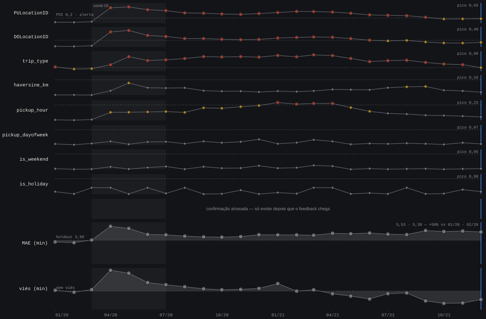

# Vigilância de drift — NYC Green Taxi

Um modelo em produção, dois anos de mundo real passando por cima dele, e a
pergunta que o projeto existe para responder: **quando é que os sinais que
você monitora param de dizer o que você acha que dizem?**

---

## O gráfico que obrigou o projeto a mudar de ideia



Oito features acima do divisor, medidas contra a distribuição congelada de
2019 (PSI). Erro e viés abaixo dele. Mesmo eixo de tempo, 24 meses de
produção simulada. Dois trechos dessa série contam histórias opostas:

| período | data drift | performance | o que está acontecendo |
|---|---|---|---|
| **jun/2020 – mar/2021** | 🔴 alerta | 🟢 estável | Os inputs estão longe de 2019 — e o modelo voltou a acertar (MAE médio 4,8 contra 3,99 do holdout). |
| **out – dez/2021** | 🟢 estável | 🔴 alerta | Os inputs voltaram para perto de 2019 — e o erro **não** voltou (MAE médio 5,4; viés negativo). |

A leitura ingênua do monitoramento de drift — "PSI subiu, modelo piorou;
PSI desceu, modelo melhorou" — erra nos dois casos. **Monitorar input não é
monitorar modelo.**

Foi essa série que fez a regra de retreino deste projeto ter **dois
gatilhos** em vez de um, e é isso que o dashboard mostra.

<!-- TODO: captura de tela da página inteira (sismógrafo + os três painéis),
     tirada no navegador depois da revisão visual do painel 3. -->

### Uma coisa que os dados NÃO mostram

Vale dizer o que não aconteceu, porque é o que costuma ser vendido: **não
houve alerta precoce no sentido cronológico.** Em mar/2020 o PSI está
abaixo do limiar de alerta em todas as features e o MAE em 4,03 (holdout:
3,99). Em abr/2020 os dois estouram **no mesmo mês**. O drift não se moveu
antes do erro.

A vantagem do drift é outra, e é de **disponibilidade**: o PSI existe no
instante em que a corrida acontece, porque só depende dos inputs. O MAE só
existe depois que a duração real chega — dias ou semanas mais tarde, em
produção de verdade. É por isso que o dashboard separa "alerta precoce" de
"confirmação atrasada", e não porque uma curva anda na frente da outra.

---

## Por que isso não é o tutorial de sempre

O dataset é o *hello world* de MLOps, e isso é proposital: com um dataset
conhecido, quem avalia já tem calibração e as diferenças saltam. As
diferenças são estas:

- **O drift é real, não sintético.** Nada de injetar ruído gaussiano numa
  feature para "simular" drift. O drift aqui é a pandemia de 2020 batendo
  num modelo treinado em 2019, com tudo que ela traz junto: colapso de
  volume, mudança de mistura de zonas, e uma relação features→duração que
  muda de regime.
- **Grupo de controle temporal.** Jan e fev de 2020 ainda são mundo normal.
  Se o PSI já aparecesse alto neles, o bug estaria na implementação, não no
  mundo — e nenhum número da pandemia seria confiável. Esse teste roda
  **antes** de qualquer interpretação e está materializado em
  [`reports/monitoring/sanity_check_report.md`](reports/monitoring/sanity_check_report.md).
- **Bins congelados de verdade.** Os cortes do PSI são calculados uma vez na
  fatia de treino e gravados no `metadata.json`. Régua que muda de tamanho
  não mede nada.
- **O leakage foi diagnosticado, não ignorado.** `trip_distance` é a
  distância do taxímetro: só existe quando a corrida acaba. Ela sai, e no
  lugar entra haversine entre centroides das zonas de embarque e desembarque
  — informação disponível no momento do embarque.
- **O bloco MNAR foi investigado.** `trip_type` vem nulo em 10,7% das
  corridas do dataset — e em 20,5% do holdout de fim de 2019, porque essa
  fração cresce ao longo do ano. A ausência não é aleatória, nem estável.
  Virou categoria própria, feature do modelo, e item de monitoramento.
- **A regra de retreino é calibrada contra a série real**, com histórico do
  que foi descartado e por quê — não um threshold escolhido no chute.
- **PSI e KS na unha.** Implementados à mão antes de qualquer biblioteca
  pronta, com testes.

O modelo é o **veículo**, não o ponto. Ele existe para ter algo real
apodrecendo em produção enquanto o mundo muda.

---

## O que está construído

**Fase 1 — ML tradicional.** Sem notebooks: scripts `.py` determinísticos
que geram outputs materializados (PNGs, relatórios `.md` gerados
programaticamente, modelo serializado + `metadata.json`).
[EDA](reports/eda/eda_report.md) · [validação](reports/evaluation/evaluation_report.md)
· [dicionário de dados](reports/data_dictionary.md)

**Fase 2 — API de inferência.** FastAPI com `POST /predict` (rápido, loga
cada request) e `POST /feedback` (o ground truth que chega depois). SQLite
em modo WAL.

**Fase 3 — Monitoramento (o núcleo).** `/monitoring/drift`,
`/performance`, `/retrain-check`, `/timeline` e `/retrain-trigger`; o
replay mês a mês de 2020-2021 contra a API; e o dashboard Streamlit que
consome **só** a API.

O `Makefile` é o índice executável do projeto, na ordem das fases:

```
make data → centroids → describe → eda → train → evaluate
make api                  # noutro terminal
make control → sanity     # grupo de controle ANTES de interpretar qualquer coisa
make replay → dashboard
```

---

## As decisões que valem discussão

**Green taxi, não yellow.** Mesmo schema, mesma fonte, mesma história de
pandemia — e arquivos ~10× menores. Isso torna o replay via HTTP viável e o
ciclo de iteração rápido, sem perder nada do valor didático.

**A feature de distância é haversine entre centroides.** Desde 2016 a TLC
não publica lat/lon, só IDs de zona. O caminho é: baixar o shapefile das
taxi zones, calcular o centroide de cada uma, e medir a distância em linha
reta entre origem e destino. É pior que a distância real — e é a única que
existe no momento em que a predição precisa ser feita.

**O mesmo `features.py` no treino e na API.** Não uma reimplementação
parecida. Diferenças pequenas entre feature engineering de treino e de
produção causam erro silencioso do modelo (*training-serving skew*), do tipo
que não quebra nada e só aparece nas métricas.

**Cálculo de monitoramento separado de inferência.** `/predict` é o caixa do
banco: responde rápido, sempre. `/monitoring/*` é a auditoria: pode ser
lenta, mas não pode travar o caixa. Por isso são routers separados, e por
isso o dashboard nunca abre o banco — ele consome a API como qualquer outro
cliente. Trocar o Streamlit por um front React não exigiria tocar no
backend.

**SQLite em WAL.** O replay martela escritas no `/predict` enquanto o
dashboard lê pelo `/monitoring/*`. Sem WAL, isso vira `database is locked`.

**Dois gatilhos de retreino, não um.** O gatilho de drift (K=2 features com
PSI > 0,2 por M=2 meses) sozinho erra de dois jeitos opostos na série real:
fica 🔴 por 17 meses seguidos, e depois dá alta em out/2021 com o modelo
ainda ruim. As duas falhas têm causas diferentes:

- O alarme longo **não é erro de threshold** — é a regra certa sem ninguém
  atendendo o alarme. Ele disparou em mai/2020 e no replay ninguém agiu, então
  a condição seguiu verdadeira. A correção é registrar o reconhecimento, não
  mexer em K e M (que ficaram como estavam).
- A alta indevida é cegueira a performance. Entra o segundo gatilho: MAE
  acima do holdout por uma margem, por M meses. A margem de +25% é calibrada
  — com +15% o alarme fica ligado 17 dos 24 meses (o defeito que ele deveria
  corrigir), com +35% ele perde quase todo o 2021.

**Reconhecer não apaga o sinal.** O botão "disparar retreino" registra que
um humano viu o alarme e assumiu a ação; o status na API continua o que os
números dizem, e só o dashboard o desenha apagado. O reconhecimento vale por
gatilho e **expira sozinho** quando aquele gatilho volta a verde — episódio
resolvido, alarme rearmado.

---

## Os números

**Modelo** (LightGBM, treino em jan–out/2019 com 5.269.684 corridas;
holdout intocado de nov–dez/2019 com 885.307):

| métrica | modelo | baseline (mediana do treino) |
|---|---|---|
| MAE | **3,99 min** | 9,44 min |
| RMSE | 7,15 min | — |
| erro absoluto mediano | 2,45 min | — |
| corridas com erro ≤ 5 min | 76,8% | — |

**Grupo de controle** (jan–fev/2020, ainda mundo normal): PSI abaixo de
0,034 em todas as features exceto `trip_type`, e MAE em 3,71 e 3,59 —
melhor que o holdout. A régua é confiável.

`trip_type` é a exceção, e é uma exceção informativa: PSI 0,237 em jan/2020,
**antes** da pandemia. Não é bug de bins — é deriva secular já visível ao
longo de 2019. PSI alto nele não é sinônimo de pandemia, e essa distinção
está no relatório do controle.

**Replay** (mar/2020–dez/2021, amostra estratificada por dia de 30k
corridas/mês com seed fixa): 24 meses, 719.997 predições, feedback em 100%,
zero falhas. O arco:

1. **Colapso.** Abr/2020: PSI de 0,61 nas zonas de embarque, MAE 6,32 e viés
   **+4,49 min** — o modelo superestima, a assinatura de ruas vazias.
2. **Novo normal instável.** Jun/2020 a set/2021: drift alto e recorrente,
   MAE oscilando entre 4,5 e 5,6 min — pior que o holdout, mas sem uma
   direção clara.
3. **Acomodação.** Out–dez/2021: o PSI esfria para a faixa de atenção e o
   gatilho de drift volta a verde, **mas o MAE segue em 5,4 com viés
   negativo** (−1,8 a −2,7): o modelo passou a subestimar. Fato observado:
   os inputs se aproximaram de 2019 e a performance não voltou. Uma
   hipótese é uma mudança durável de regime na relação features→duração —
   *não verificável com estes dados*.

**Resíduos por grupo**, o critério que decidiu "um modelo ou dois":

| grupo | share | MAE | viés |
|---|---|---|---|
| street-hail | 78,1% | 3,53 | −1,15 |
| bloco MNAR (`trip_type` ausente) | 20,5% | 5,56 | −1,06 |
| despachada | 1,4% | 6,52 | −2,97 |

Um modelo único com `trip_type` como feature ficou. O viés extra na
despachada existe, mas ela é 1,4% do tráfego — virou item de monitoramento,
não um segundo modelo.

---

## Como rodar

Requer [uv](https://docs.astral.sh/uv/). O download dos parquets de 36 meses
e o replay completo levam horas — `make help` lista os alvos e eles rodam
isoladamente.

```bash
make install
make data centroids describe eda train evaluate   # fase 1
make api                                          # fase 2, noutro terminal
make control sanity                               # grupo de controle
make replay                                       # fase 3
make dashboard
```

`make test` roda os 75 testes de `features.py` e `drift.py` — as duas peças
com lógica que falha calada (haversine, bins de PSI, streaks dos gatilhos).

---

## Limites conhecidos

Ditos em voz alta porque a alternativa é alguém descobrir sozinho:

- **O retreino é mock.** O botão registra o reconhecimento e não treina
  nada. Isso é escopo, não pendência: o projeto é sobre monitoramento.
- **Testes cobrem `features.py` e `drift.py`, não a API.** As camadas de
  router e banco foram verificadas à mão contra o replay real.
- **As zonas 264 (Unknown) e 265 (Outside NYC) não têm centroide** no
  shapefile, então a haversine sai NaN em ~0,4% das corridas. O NaN tem bin
  próprio no PSI, ou seja, é contado em vez de ignorado — mas continua NaN.
- **`trip_type` contamina a contagem de features em alerta**, pela deriva
  secular acima. Ficou na conta de propósito: com o reconhecimento em vigor
  ele só muda o status em jul–set/2021, meses em que o alarme já estaria
  silenciado.
- **Fora de escopo por decisão**: orquestração (Airflow/Prefect), deploy em
  nuvem, CI/CD. Tudo roda local.

Contexto completo das decisões, com os porquês e o que foi descartado, em
[`CLAUDE.md`](CLAUDE.md).
