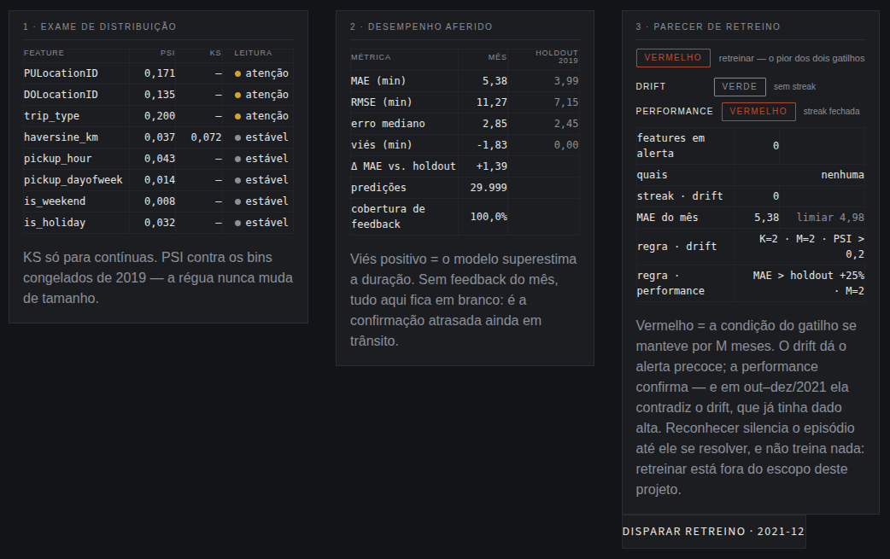

# Drift watch — NYC Green Taxi

**English** · [Português](README.pt-BR.md)

One model in production, two years of the real world rolling over it, and
the question this project exists to answer: **when do the signals you
monitor stop meaning what you think they mean?**

---

## The chart that made the project change its mind


Eight features above the divider, measured against the frozen 2019
distribution (PSI). Error and bias below it. Same time axis, 24 months of
simulated production. Two stretches of this series tell opposite stories:

| period | data drift | performance | what is happening |
|---|---|---|---|
| **Jun 2020 – Mar 2021** | 🔴 alert | 🟢 stable | The inputs are far from 2019 — and the model is accurate again (mean MAE 4.8 vs. 3.99 on the holdout). |
| **Oct – Dec 2021** | 🟢 stable | 🔴 alert | The inputs are back close to 2019 — and the error did **not** come back down (mean MAE 5.4; negative bias). |

The naive reading of drift monitoring — "PSI went up, the model got worse;
PSI went down, the model got better" — is wrong in both cases. **Monitoring
inputs is not monitoring the model.**

This series is why the retraining rule in this project has **two triggers**
instead of one, and that is what the dashboard shows.

### The same argument, in exact numbers



Below the seismograph, three panels break down the month the needle is on —
here, **Dec 2021**, the second case in the table above.

Read left to right: **no feature in alert** (the highest PSI is 0.200, in
the warning band); **MAE at 5.38 vs. 3.99 on the holdout**, with a bias of
−1.83; and the verdict, which is where the two meet — **drift green** ("no
streak"), **performance red** ("streak closed"), and the overall verdict
**red**, because it is the worse of the two.

This is the month in which a drift-only rule would have discharged the
patient.

### One thing the data does NOT show

It is worth stating what did not happen, because it is what usually gets
sold: **there was no early warning in the chronological sense.** In March
2020 PSI is below the alert threshold on every feature and MAE is 4.03
(holdout: 3.99). In April 2020 both blow up **in the same month**. Drift did
not move before the error did.

The advantage of drift lies elsewhere, in **availability**: PSI exists the
moment the trip happens, because it depends only on the inputs. MAE only
exists once the actual duration arrives — days or weeks later, in real
production. That is why the dashboard separates "early warning" from
"delayed confirmation", and not because one curve runs ahead of the other.

---

## Why this is not the usual tutorial

This dataset is the *hello world* of MLOps, and that is on purpose: with a
well-known dataset, the reviewer is already calibrated and the differences
stand out. Here they are:

- **The drift is real, not synthetic.** No injecting Gaussian noise into a
  feature to "simulate" drift. The drift here is the 2020 pandemic hitting a
  model trained in 2019, with everything it brings along: volume collapse, a
  shift in the zone mix, and a features→duration relationship that changes
  regime.
- **Temporal control group.** January and February 2020 are still the normal
  world. If PSI were already high there, the bug would be in the
  implementation, not in the world — and no pandemic number could be
  trusted. This test runs **before** any interpretation and is materialized
  in [`reports/monitoring/sanity_check_report.md`](reports/monitoring/sanity_check_report.md)
  (in Portuguese).
- **Truly frozen bins.** PSI cut points are computed once on the training
  slice and stored in `metadata.json`. A ruler that changes length measures
  nothing.
- **Leakage was diagnosed, not ignored.** `trip_distance` is the meter
  distance: it only exists once the trip ends. It is dropped, and replaced by
  the haversine distance between the centroids of the pickup and dropoff
  zones — information available at pickup time.
- **The MNAR block was investigated.** `trip_type` is null in 10.7% of the
  dataset's trips — and in 20.5% of the late-2019 holdout, because that
  fraction grows over the year. The missingness is neither random nor
  stable. It became its own category, a model feature, and a monitoring
  item.
- **The retraining rule is calibrated against the real series**, with a
  record of what was discarded and why — not a threshold picked by guesswork.
- **PSI and KS by hand.** Implemented manually before any off-the-shelf
  library, with tests.

The model is the **vehicle**, not the point. It exists so there is something
real rotting in production while the world changes.

---

## What is built

**Phase 1 — Classic ML.** No notebooks: deterministic `.py` scripts that
produce materialized outputs (PNGs, programmatically generated `.md`
reports, serialized model + `metadata.json`).
[EDA](reports/eda/eda_report.md) · [validation](reports/evaluation/evaluation_report.md)
· [data dictionary](reports/data_dictionary.md) (reports in Portuguese)

**Phase 2 — Inference API.** FastAPI with `POST /predict` (fast, logs every
request) and `POST /feedback` (the ground truth that arrives later). SQLite
in WAL mode.

**Phase 3 — Monitoring (the core).** `/monitoring/drift`, `/performance`,
`/retrain-check`, `/timeline` and `/retrain-trigger`; the month-by-month
replay of 2020–2021 against the API; and the Streamlit dashboard that
consumes **only** the API.

The `Makefile` is the project's executable index, in phase order:

```
make data → centroids → describe → eda → train → evaluate
make api                  # in another terminal
make control → sanity     # control group BEFORE interpreting anything
make replay → dashboard
```

---

## The decisions worth discussing

**Green taxi, not yellow.** Same schema, same source, same pandemic story —
and files ~10× smaller. That makes HTTP replay feasible and the iteration
loop fast, without losing any of the learning value.

**The distance feature is haversine between centroids.** Since 2016 the TLC
no longer publishes lat/lon, only zone IDs. The path is: download the taxi
zones shapefile, compute each zone's centroid, and measure the straight-line
distance between origin and destination. It is worse than the real distance
— and it is the only one that exists at the moment the prediction has to be
made.

**The same `features.py` in training and in the API.** Not a similar-looking
reimplementation. Small differences between training and production feature
engineering cause silent model error (*training-serving skew*), the kind
that breaks nothing and only shows up in the metrics.

**Monitoring computation separated from inference.** `/predict` is the bank
teller: it answers fast, always. `/monitoring/*` is the audit department: it
can be slow, but it must never block the teller. That is why they are
separate routers, and why the dashboard never opens the database — it
consumes the API like any other client. Swapping Streamlit for a React
frontend would not require touching the backend.

**SQLite in WAL.** The replay hammers writes on `/predict` while the
dashboard reads through `/monitoring/*`. Without WAL, that turns into
`database is locked`.

**Two retraining triggers, not one.** The drift trigger alone (K=2 features
with PSI > 0.2 for M=2 months) fails in two opposite ways on the real
series: it stays 🔴 for 17 months straight, and then gives a clean bill of
health in October 2021 with the model still performing badly. The two
failures have different causes:

- The long alarm **is not a threshold error** — it is the right rule with
  nobody answering the alarm. It fired in May 2020 and nobody acted during
  the replay, so the condition stayed true. The fix is to record the
  acknowledgment, not to tweak K and M (which were left as they were).
- The undue all-clear is blindness to performance. Enter the second trigger:
  MAE above the holdout by a margin, for M months. The +25% margin is
  calibrated — with +15% the alarm stays on 17 of 24 months (the very defect
  it was supposed to fix), with +35% it misses almost all of 2021.

**Acknowledging does not erase the signal.** The "trigger retraining" button
records that a human saw the alarm and took ownership; the status in the API
stays whatever the numbers say, and only the dashboard draws it dimmed. The
acknowledgment applies per trigger and **expires on its own** when that
trigger goes back to green — episode resolved, alarm re-armed.

---

## The numbers

**Model** (LightGBM, trained on Jan–Oct 2019 with 5,269,684 trips; untouched
holdout of Nov–Dec 2019 with 885,307):

| metric | model | baseline (training median) |
|---|---|---|
| MAE | **3.99 min** | 9.44 min |
| RMSE | 7.15 min | — |
| median absolute error | 2.45 min | — |
| trips with error ≤ 5 min | 76.8% | — |

**Control group** (Jan–Feb 2020, still the normal world): PSI below 0.034 on
every feature except `trip_type`, and MAE at 3.71 and 3.59 — better than the
holdout. The ruler can be trusted.

`trip_type` is the exception, and an informative one: PSI 0.237 in January
2020, **before** the pandemic. It is not a binning bug — it is secular drift
already visible throughout 2019. A high PSI on it is not a synonym for the
pandemic, and that distinction is in the control report.

**Replay** (Mar 2020–Dec 2021, day-stratified sample of 30k trips/month with
a fixed seed): 24 months, 719,997 predictions, 100% feedback, zero failures.
The arc:

1. **Collapse.** April 2020: PSI of 0.61 on pickup zones, MAE 6.32 and bias
   **+4.49 min** — the model overestimates, the signature of empty streets.
2. **Unstable new normal.** June 2020 to September 2021: high, recurring
   drift, MAE oscillating between 4.5 and 5.6 min — worse than the holdout,
   but with no clear direction.
3. **Settling.** October–December 2021: PSI cools down to the warning band
   and the drift trigger goes back to green, **but MAE stays at 5.4 with a
   negative bias** (−1.8 to −2.7): the model now underestimates. Observed
   fact: the inputs moved closer to 2019 and performance did not come back.
   One hypothesis is a lasting regime change in the features→duration
   relationship — *not verifiable with this data*.

**Residuals by group**, the criterion that decided "one model or two":

| group | share | MAE | bias |
|---|---|---|---|
| street-hail | 78.1% | 3.53 | −1.15 |
| MNAR block (`trip_type` missing) | 20.5% | 5.56 | −1.06 |
| dispatched | 1.4% | 6.52 | −2.97 |

A single model with `trip_type` as a feature stayed. The extra bias on
dispatched trips is real, but they are 1.4% of traffic — it became a
monitoring item, not a second model.

---

## How to run

Requires [uv](https://docs.astral.sh/uv/). Downloading 36 months of parquet
files and running the full replay take hours — `make help` lists the
targets, and each one runs on its own.

```bash
make install
make data centroids describe eda train evaluate   # phase 1
make api                                          # phase 2, in another terminal
make control sanity                               # control group
make replay                                       # phase 3
make dashboard
```

`make test` runs the 148 tests: `features.py` and `drift.py` — the two
pieces whose logic fails silently (haversine, PSI bins, trigger streaks) —
plus the API, on fake model and centroids, covering both triggers end to end
and the acknowledgment and its expiry.

---

## Known limitations

Stated out loud, because the alternative is someone discovering them alone:

- **Retraining is a mock.** The button records the acknowledgment and trains
  nothing. That is scope, not a to-do: the project is about monitoring.
- **API tests run on fakes.** `models/*.pkl` and `data/processed/` are not
  in git, so the API suite uses a fake model and centroids; the end-to-end
  path against the real model was verified by the replay itself.
- **Zones 264 (Unknown) and 265 (Outside NYC) have no centroid** in the
  shapefile, so haversine comes out NaN in ~0.4% of trips. NaN has its own
  PSI bin, meaning it is counted rather than ignored — but it is still NaN.
- **`trip_type` contaminates the count of features in alert**, because of
  the secular drift above. It stayed in on purpose: with the acknowledgment
  in place it only changes the status in Jul–Sep 2021, months in which the
  alarm would already be silenced.
- **Out of scope by decision**: orchestration (Airflow/Prefect), cloud
  deployment, CI/CD. Everything runs locally.

The full context of the decisions, with the reasons and what was discarded,
is in [`CLAUDE.md`](CLAUDE.md) (in Portuguese).
