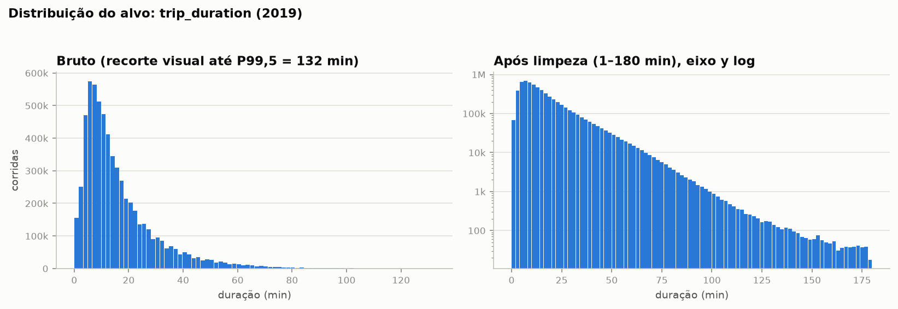
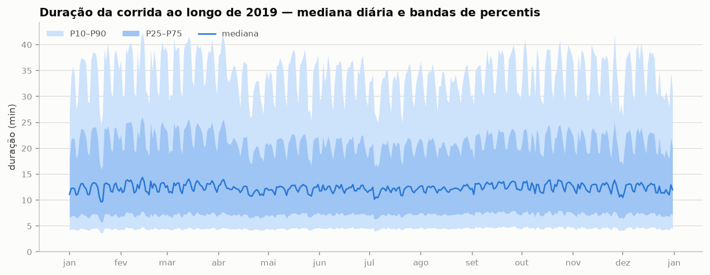
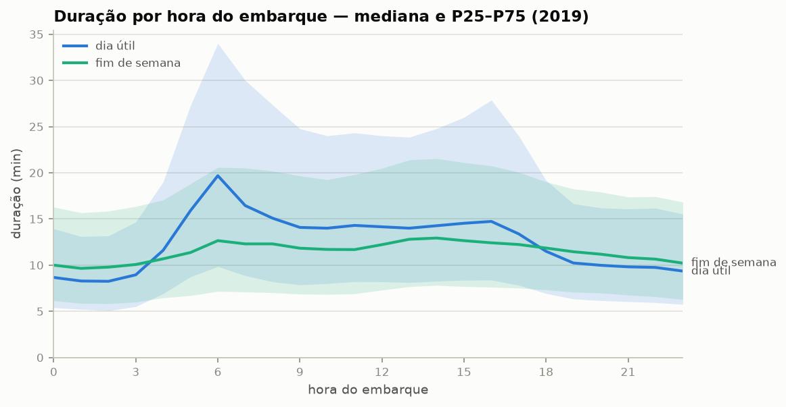
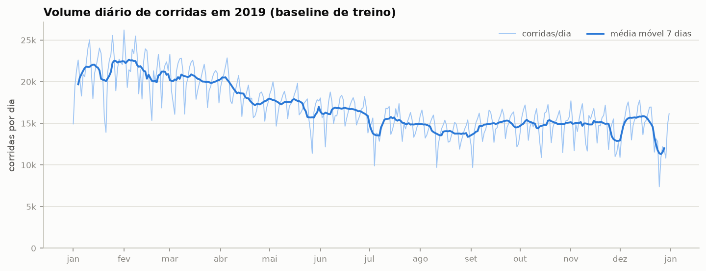
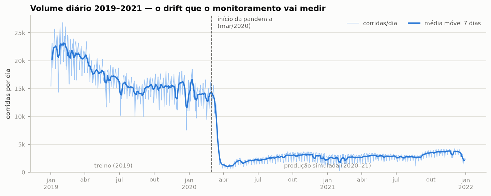
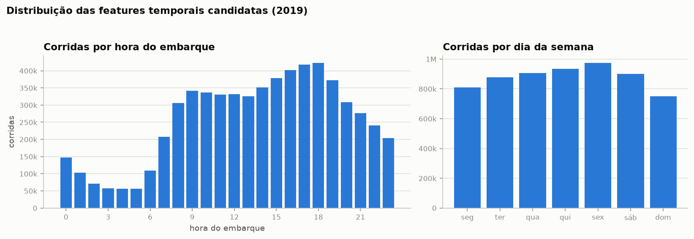
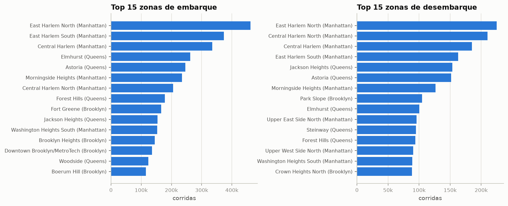

# EDA — NYC Green Taxi 2019 (baseline de treino)

Gerado por `src/eda.py` a partir dos 12 parquets de 2019
(6,300,985 corridas brutas; 6,155,040 após limpeza).
Nenhuma etapa usa amostragem — o relatório cobre todas as corridas do ano.

## 1. Alvo: `trip_duration`

Definição: `lpep_dropoff_datetime − lpep_pickup_datetime`, em minutos.
Antes de qualquer corte, 273 corridas com pickup fora de
2019 (timestamps de 2008 a 2062) foram removidas por sanidade temporal.

Percentis da duração bruta:

| percentil | duração (min) |
|---|---|
| mín | -368,627.5 |
| P1 | 0.2 |
| P5 | 2.9 |
| P25 | 7.0 |
| P50 (mediana) | 12.2 |
| P75 | 21.2 |
| P95 | 46.1 |
| P99 | 77.3 |
| P99,9 | 1,426.0 |
| máx | 9,820.5 |

A cauda é extrema: 14,572 corridas com duração ≤ 0
(taxímetro ligado/desligado no mesmo instante ou timestamps invertidos) e
29,979 acima de 180 min (esquecimento de
desligar o taxímetro, não corridas reais).

**Cortes de limpeza adotados: 1 min ≤ duração ≤
180 min**, removendo 145,672 corridas
(2.31% do ano). Os valores vivem em `features.py`
(constantes `DUR_MIN_MINUTES`/`DUR_MAX_MINUTES`), fonte única para EDA,
treino e API.

*À esquerda, a distribuição bruta (recorte visual no P99,5); à direita, a
distribuição limpa em escala log — assimetria à direita forte, mediana em
12.2 min. Confirma a escolha de mediana + quartis (e não média ± σ)
nas séries temporais abaixo.*

## 2. Alvo ao longo do tempo

*Mediana diária com bandas P25–P75 e P10–P90 (dados limpos). A banda é
estável ao longo do ano — este é o "mundo normal" que o modelo vai aprender
e que o PSI vai usar como régua.*

## 3. Perfil por hora do dia

*Em dias úteis a mediana sobe nos horários de pico e a banda alarga; no fim
de semana o perfil é mais chato. Esta é exatamente a relação features→alvo
que o concept drift da pandemia deve quebrar (ruas vazias → corridas mais
rápidas nos mesmos horários). O pico das 6h é em parte **efeito de
composição**, não só trânsito: a subpopulação de corridas despachadas (o
bloco MNAR do dicionário de dados) chega a ~25% das corridas na madrugada,
com medianas de ~30 min — excluindo-a, a mediana das 6h cai de ~20 para
~15 min.*

## 4. Volume de corridas

*Sazonalidade semanal clara (dia útil vs. fim de semana), mas o baseline
**não é estacionário**: o volume médio diário cai
32% entre jan e dez de 2019 — o green taxi já
vinha encolhendo antes da pandemia (uma hipótese comum é a competição dos
apps de transporte, mas isso não é verificável com estes dados).
Implicação para o monitoramento: alguma deriva de volume é o estado normal
deste serviço; o que a pandemia adiciona é uma mudança de outra ordem de
grandeza, e é isso que os thresholds de PSI precisam separar.*

*A única espiada além de 2019: o penhasco de mar/2020. O volume mensal cai de
398,647 corridas (fev/2020) para 35,642
(abr/2020) — queda de 91% — e termina 2021 em
99,956, sem recuperar o patamar pré-pandemia. É este evento
que as fases 2–3 vão detectar via PSI/KS sem olhar este gráfico.*

## 5. Features temporais candidatas

*Distribuições que os bins congelados do PSI vão medir: pico vespertino
(15h–19h) e volume maior em dias úteis.*

*Concentração geográfica alta (green taxi atende principalmente norte de
Manhattan, Brooklyn e Queens). PU/DO LocationID alimentam a feature de
distância haversine entre centroides (features.py).*

## 6. Sanidade dos LocationIDs

| coluna | zona 264 (Unknown) | zona 265 (Outside NYC) | fora do lookup | % desconhecida |
|---|---|---|---|---|
| `PULocationID` | 2,713 | 2,620 | 0 | 0.09% |
| `DOLocationID` | 5,698 | 13,781 | 0 | 0.32% |

Zonas 264/265 não têm centroide no shapefile → a feature haversine será NaN
nessas corridas. A fração é pequena; decidir em `features.py` entre descartar
as linhas ou imputar (ex.: mediana da distância).

## 7. Implicações para as próximas fases

- **Limpeza herdada**: sanidade temporal (pickup dentro do período) +
  duração em [1, 180] min.
- **Alvo assimétrico**: avaliar treino sobre `log(duration)` em `train.py`;
  reportar MAE/RMSE na escala original em `evaluate.py`.
- **Bins do PSI**: hora do dia e dia da semana têm distribuições bem
  comportadas; os bins congelados devem vir da distribuição 2019 completa
  (ver regra no CLAUDE.md).
- **Correlação distância↔duração**: pendente até `features.py` materializar o
  haversine entre centroides — a EDA dela entra no relatório de features.
- **Zonas 264/265**: tratar explicitamente em `features.py` (NaN de
  haversine).
