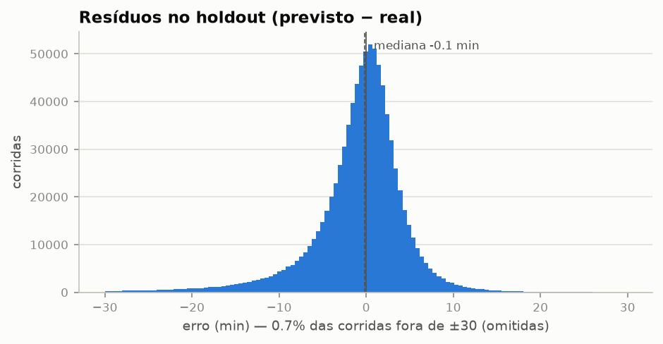
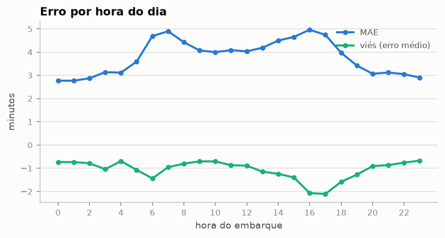
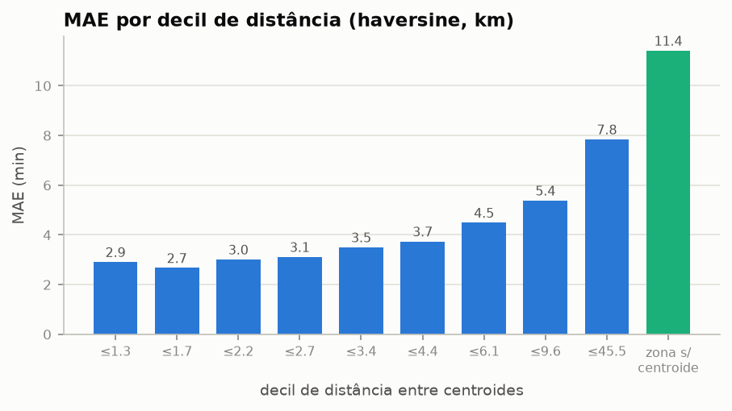
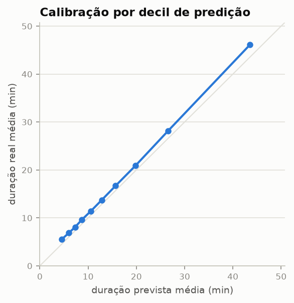

# Validação do modelo — holdout 2019-11 a 2019-12

Gerado programaticamente por `src/evaluate.py`. Modelo
`0.1.0` (lightgbm==4.6.0), treinado em
2019-01..2019-10
(5,269,684 corridas). Holdout **intocado no treino**:
885,307 corridas.

## 1. Métricas gerais

| métrica | modelo | baseline (mediana do treino) |
|---|---|---|
| MAE | 3.99 min | 9.44 min |
| RMSE | 7.15 min | — |
| erro absoluto mediano | 2.45 min | — |
| P90 do erro absoluto | 8.53 min | — |
| corridas com erro ≤ 5 min | 76.8% | — |

## 2. Distribuição dos resíduos

*Mediana do resíduo em -0.1 min (o objetivo L1 mira a mediana
condicional), mas média em -1.2 min: a cauda esquerda é mais
pesada — quando o modelo erra muito, é mais frequentemente por **subestimar**
a duração.*

## 3. Resíduos por grupo (trip_type) — critério da decisão "um modelo ou dois"

| grupo | n | share | dur_mediana_min | vies_min | mae_min | ae_mediano_min |
|---|---|---|---|---|---|---|
| bloco MNAR (canal reduzido) | 181,643 | 20.5% | 24.0 | -1.06 | 5.56 | 3.78 |
| street-hail | 691,580 | 78.1% | 10.7 | -1.15 | 3.53 | 2.20 |
| despachada | 12,084 | 1.4% | 14.4 | -2.97 | 6.52 | 3.30 |

*O viés dos dois grupos grandes é praticamente o mesmo
(-1.15 min no street-hail vs
-1.06 no bloco MNAR): a subestimação é compartilhada
entre grupos, não específica de um deles. Em erro **relativo à duração
típica**, o bloco MNAR (5.56 min de MAE sobre mediana de
24 min ≈ 23%) sai melhor que o
street-hail (33%) — o modelo único **com** a feature não falha
sistematicamente no grupo grande.*

*A exceção é a despachada explícita (trip_type=2): viés de
-2.97 min, 1.8 min além do viés
compartilhado — subestimação sistemática real, mas num grupo com
1.4% do holdout.*

***Veredito: um modelo único com a feature fica.** Dois modelos não se
justificam por 1.4% do tráfego; o ponto vira item de
monitoramento — se a fração de despachadas crescer (o PSI de trip_type vigia
exatamente essa mistura), a decisão é revisitada.*

## 4. Erro por hora do dia

*O MAE acompanha os picos de trânsito (7h e 16–17h). O viés só afunda de
verdade no pico da tarde (~−2 min às 16–17h): é o horário em que o modelo
mais subestima; no pico da manhã o erro cresce sem viés extra.*

## 5. Erro por distância

*O erro cresce monotonicamente com a distância. Corridas sem centroide
(zonas 264/265, haversine NaN; 0.4% do holdout) têm MAE de
11.4 min — o modelo degrada sem a feature principal, mas continua
respondendo; aceitável enquanto o grupo for marginal, e é mais um item que o
monitoramento de inputs enxerga (bin de NaN no PSI).*

## 6. Calibração

*Os decis andam paralelos à diagonal com deslocamento quase constante de
~1 min (real acima do previsto): o desvio é aditivo e
uniforme, não um problema de inclinação. Hipótese (não testada aqui):
nov–dez é mais lento que a média de jan–out por sazonalidade — o replay de
2020–2021 dirá se o padrão persiste fora da estação.*
